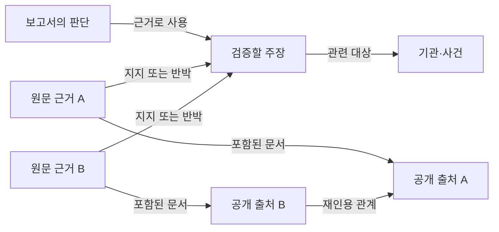

# T2-1 PRD: 멀티소스 OSINT 인텔 코파일럿

| 항목 | 내용 |
| --- | --- |
| 버전 | v0.3 |
| 작성일 | 2026-10-10 |
| 상태 | 공식 과제 방향을 반영한 로컬 구현·검증 진행 |
| 대상 과제 | T2-1 — Fusion OSINT Copilot |
| 현재 위치 | T2-1부터 개발. 최초 T2-2 검토 배경은 README에 보존. |
| 핵심 차별점 | 질문 적합성 검증, 출처 독립성 검증, Wisdom Graph의 추적 가능한 추론, 최근 조사 질문 추천 |

## 1. 제품 정의

**공개 자료에 자연어로 질문하면, 여러 출처를 연결해 보고서를 만들고 각 판단의 원문 근거와 독립적으로 확인된 정도를 보여주는 OSINT 코파일럿.**

제품의 핵심 가치는 분석가가 결과를 검증하는 시간을 줄이는 것이다. 사용자는 보고서의 판단을 선택해 관련 주장, 원문 문장, 출처, 재인용 관계를 확인하고, 근거가 충분한 부분과 추가 확인이 필요한 부분을 구분할 수 있어야 한다.

### 공식 과제 요구사항

[공식 과제 시트의 「B-2. 트랙별 문제」 탭, T2-1 행](https://docs.google.com/spreadsheets/d/1z-knlD7tXlieexed2eHruSseUu6dBYt3K-mT5NAbXHg/edit?gid=851891445#gid=851891445)을 기준으로 다음을 충족한다.

- 자연어 질의를 받아 복수의 공개 출처 수집·분석 모듈을 연결한다.
- 출처 간 교차검증을 수행한다.
- 출처와 신뢰도를 명시한 인텔 리포트 및 시각화를 생성한다.
- 공개 데이터만 사용하고, APAC 관심 이슈를 최소 1개 시연한다.

한·중·일·러 수집·번역·요약, 엔티티·관계·타임라인·지도, 분석가 검토·승인을 제품 요구사항에 포함한다. MCP는 수집 모듈 연결 방식의 예시다. 고정 자료 시연만으로 복수 출처 수집·자연어 분석 요구를 충족했다고 판단하지 않는다. SC1 연계는 별도 범위로 둔다.

### 팀이 정한 방향과 이 문서의 가정

- 팀은 다른 과제보다 의존성이 적다는 판단으로 T2-1을 백업 후보로 선택했다.
- KG를 통한 추적 가능성과 투명성은 팀의 구상이며, 출처 독립성 검증은 대화에서 채택한 추가 차별점이다.
- 아래의 시연 주제, 기능 우선순위, 수치 목표, 역할 분담은 **구현을 시작하기 위한 제안**이다. 아직 성능이나 데이터 확보가 검증된 상태는 아니다.
- 2인 팀이 약 24시간 안에 시연 가능한 MVP를 만드는 상황을 가정한다. 실제 남은 시간에 따라 작업 계획을 조정한다.
- 특수 하드웨어나 비공개 데이터 없이 진행한다. 공개 원문 확보와 모델 사용 환경은 준비가 필요하며, 외부 API 사용 여부는 구현 시 결정한다.

## 2. 문제와 대상 사용자

분석가는 여러 자료를 읽고 동일한 사건·기관·발표를 연결한 뒤, 각 결론이 어떤 자료에 기대고 있는지 다시 확인해야 한다. 서로 다른 매체의 기사라도 같은 발표를 재인용했을 수 있어, 문서 수만으로 교차검증의 강도를 판단하기 어렵다.

| 사용자 | 주요 작업 | 제품이 제공할 가치 |
| --- | --- | --- |
| 국방·안보 분야 공개정보 분석가 | 사건 개요 파악, 근거 비교, 보고서 초안 작성 | 주장별 근거와 검증 상태를 한 화면에서 확인 |
| 분석 결과를 검토하는 군 도메인 전문가 | 용어·맥락 확인, 판단의 타당성 검토 | 원문으로 되돌아가 판단을 검토하고 수정 |
| 브리핑을 받는 의사결정 지원 담당자 | 확인된 내용과 정보 공백 구분 | 핵심 판단, 근거 수준, 추가 확인 사항을 함께 파악 |

MVP의 주 사용자는 공개정보 분석가로 한정한다. 친구의 국방 전문 지식은 시나리오 선정과 분석 결과 검토에 활용한다.

## 3. 목표와 성공 기준

### 제품 목표

1. 자연어 질문에서 근거가 연결된 보고서까지 한 흐름으로 완주한다.
2. 보고서의 주요 판단에서 원문 문장까지 추적할 수 있다.
3. 같은 원출처를 재인용한 자료 때문에 근거 수와 신뢰도가 부풀려지는 것을 줄인다.
4. 근거가 부족하거나 상충하면 그 상태를 명시한다.

### MVP 완료 기준

아래 수치는 데모용 공개 자료와 사전 정의한 평가 질문에서 확인할 목표다. 범용 OSINT 성능을 보장하는 지표로 사용하지 않는다.

| 지표 | 목표 | 확인 방법 |
| --- | --- | --- |
| 전체 사용자 흐름 | APAC 이슈 1개에 대해 질문 → 수집 → 분석 → 보고서 → 근거 확인 완료 | 실제 공개 자료로 브라우저 시연 |
| 판단의 추적 가능성 | 보고서의 모든 사실 주장에 유효한 원문 근거 연결 | 주장별 출처 ID·원문 위치 검사와 원문이 주장을 뒷받침하는지 수동 확인 |
| 원문 접근성 | 보고서에서 선택한 주장의 원문 근거를 2회 이내 클릭으로 확인 | 사용자 흐름 점검 |
| 출처 중복 처리 | 확인된 재인용 사례가 독립 근거 수를 늘리지 않음 | 검토된 재인용 사례 최소 3개로 확인 |
| 근거 부족 처리 | 자료에 없는 답을 요구하는 질문에 근거 부족 표시 | 해당 평가 질문으로 확인 |
| 상충 처리 | 상충하는 근거를 함께 표시하고 자동 확정하지 않음 | 실제 사례 또는 명시적으로 표시한 검증용 fixture로 확인 |
| 응답 시간 | 저장 자료 모드에서 보고서 완성까지 60초 이내 | 동일 환경에서 평가 질문 5개 측정 |
| 재현성 | 저장 자료 모드에서 질문 5개를 연속 실행해 수집·근거 화면 오류 없이 완료 | 데모 리허설 |

실시간 수집의 소요 시간과 성공률은 별도로 기록한다. 저장 자료 모드의 결과와 섞어 성능을 보고하지 않는다.

## 4. 시연 주제와 데이터 범위

### 우선 시나리오

**한·미·일 공개 연합훈련 발표에 대한 일정, 참가국, 발표 목적의 교차검증**을 우선 시나리오로 제안한다. 실제 사건 하나와 기간은 원문 확보 후 확정한다.

예시 질문:

> 선정한 연합훈련의 일정, 참가국, 발표 목적을 공개 자료로 정리해줘. 독립적으로 확인된 내용과 같은 발표를 재인용한 내용을 구분해줘.

추가 질문은 “참가국을 확인하는 근거는 몇 묶음인가?”, “이 판단의 원문은 무엇인가?”, “수집한 자료만으로 확인하기 어려운 내용은 무엇인가?”로 구성한다.

### 데이터 준비 목표

- 같은 사건을 다루는 실제 공개 문서 8~15개를 확보한다.
- 정부·기관 발표와 언론 기사 등 최소 2종의 출처 유형을 포함한다.
- 한·중·일·러 수집·번역 경로를 마련하고, 영어 원문도 지원한다. 언어별 검색 시도와 실제 확보한 원문을 구분한다. 최소 3개 발행기관의 자료 확보를 목표로 한다. 발행기관 수가 독립 근거 수를 뜻하지는 않는다.
- 확인 가능한 재인용 관계와 서로 다른 원출처의 자료를 포함하도록 선정한다.
- 원문 URL, 제목, 발행기관, 발행일, 수집 시각, 원문 본문을 보존한다. 발행일을 확인할 수 없으면 미상으로 기록한다.
- 친구가 핵심 주장 5~10개와 원문 근거, 재인용 여부를 검토해 평가 기준을 만든다. 독립성 판단이 어려운 자료는 미확인으로 남긴다.

재인용 사례를 확보하지 못하면 같은 조건을 만족하는 다른 APAC 공개 안보 이슈로 교체한다. 제품의 핵심 시연에 필요한 사례 확보를 우선한다.

실제 시연 데이터에 가상의 사건이나 인용을 섞지 않는다. 상충·오류 처리 검증에 합성 자료가 필요하면 별도 검증용 자료로 표시한다.

## 5. MVP 기능 요구사항

P0는 시연 전에 모두 충족할 기능이고, P1은 P0 완료 후 시간이 남으면 추가할 기능이다.

| ID | 우선순위 | 기능 | 완료 조건 |
| --- | --- | --- | --- |
| FR-01 | P0 | 자연어 질의 | 질문과 대상 기간을 받고, 분석 대상·자료 범위·처리 상태를 표시한다. 범위 밖 질문은 지원 범위를 안내한다. |
| FR-02 | P0 | 복수 출처 수집 | 기관 발표와 뉴스 자료를 각각 가져오는 모듈을 연결한다. 질문별 검색 질의와 공개 URL을 실행해 실제 본문을 수집한다. 성공·실패 출처, 원문 언어, 발행일을 기록한다. |
| FR-03 | P0 | 주장 및 근거 추출 | 질문을 답변 항목으로 분해하고 항목별 사실을 추출한다. 한·중·일·러 원문과 한국어 번역을 보존한다. 원문 위치 검사와 별도 내용 대조에서 탈락한 인용은 제외한다. |
| FR-04 | P0 | KG 구성 | 판단·주장·원문 근거·출처·기관/사건 사이의 관계를 저장하고, 보고서에서 해당 경로를 탐색할 수 있다. |
| FR-05 | P0 | 출처 독립성 검증 | 재인용·공통 원출처 관계를 주장별로 묶고, 원문 문서 수와 근거 묶음 수를 구분한다. 불명확한 관계는 미확인으로 표시한다. |
| FR-06 | P0 | 검증 상태와 신뢰도 설명 | 주장별 교차 확인·단일 원출처·상충·독립성 미확인·근거 부족을 구분하고, 신뢰도 수준과 이유를 표시한다. |
| FR-07 | P0 | 인텔 리포트 생성 | 요약, 주요 판단, 인용, 검증 상태, 정보 공백, 자료 기준 시각을 포함한다. 사실과 시스템의 해석을 구분한다. |
| FR-08 | P0 | 근거 시각화 | 선택한 판단과 관련된 부분 그래프 및 근거 목록을 표시한다. 원문 패널에서 관련 문장을 강조한다. |
| FR-09 | P0 | 분석가 검토 | 원출처 병합·분리·독립성 판정과 보고서 승인·보완 요청을 지원한다. 검토자·이유·버전을 기록하고, 근거 변경 후 현재 승인을 해제한다. |
| FR-10 | P0 | 저장 자료 모드 | 확보한 공개 원문과 검증된 추출 결과로 같은 질의·검증 흐름을 재현한다. 사용 중인 자료 기준 시각과 모드를 표시한다. |
| FR-11 | P1 | 보고서 내보내기 | 인용, 검증 상태, 검토 기록을 포함한 Markdown 보고서를 다운로드한다. |
| FR-12 | P0 | 사건 타임라인 | 발행일과 사건 날짜를 구분해 표시하고, 날짜 근거를 확인할 수 있다. |
| FR-13 | P0 | 질문별 공개 검색 | 질문에 따라 공식 발표·언론·논문 모듈을 선택한다. 수집 실패를 기록하고 확보한 원문으로 분석한다. |
| FR-14 | P0 | 근거 기반 지도 | 원문 수치 좌표와 근거 인용을 연결하고, 좌표 근거가 없는 경우 지도에 추정 위치를 표시하지 않는다. |
| FR-15 | P0 | 질문 적합성 및 재탐색 | 지역·기간·검증 가설과 가정을 표시하고, 원문을 직접 근거·배경·무관으로 구분한다. 누락 항목을 보완 검색하고, 배경 논문만으로 현지 여론 질문에 답하지 않는다. |
| FR-16 | P0 | Wisdom Graph 추론 | 검증된 방향 관계의 경로를 합성하고, 연결된 복수 판단에서 설명 가설을 제안·재검증한다. 전제 노드·에지·원문, 신뢰도, 한계, 경쟁 설명, 다음 검증 항목을 확인할 수 있다. |
| FR-17 | P0 | 선제적 조사 질문 추천 | 최근 14일 국방·안보 원문을 탐색하고 발행일·내용을 검증한 사건에서 조사 질문을 제안한다. 선택 시 질문·원문 URL을 입력하고 사용자가 분석을 실행한다. 미확보 시 고정 예시를 최신 추천으로 대체하지 않는다. |

### Wisdom Graph와 추천의 판단 경계

- 경로 합성은 명시적으로 검증된 인용·재게시 및 응답 관계에 한정한다. 시간 순서·비슷한 표현만으로 인과관계나 공모를 생성하지 않는다.
- 설명 가설은 연결된 판단 2개 이상을 필요로 하며, 전제 ID 존재·연결 경로 검사와 별도의 모델 내용 대조를 통과해야 한다. 사실과 추론을 화면에서 구분한다.
- 설명 가설은 조사 결론의 자동 확정이 아니다. 경쟁 설명과 이를 구별할 관측을 함께 제공하고, 전제 검토 후 신뢰도를 다시 계산한다.
- 추천은 최근 공개 보도에서 찾은 조사 후보다. 언급량을 측정한 인기 순위가 아니다. 화면 접근 시 수집하고 6시간 캐시를 공유하며, 서버 상시 감시·주기 작업은 포함하지 않는다.
- 공개적으로 색인된 게시물은 검색할 수 있지만, 유튜브·커뮤니티 댓글 전체의 대표성 있는 수집·여론 비중 측정은 아직 지원하지 않는다.

### 이번 MVP에서 제외하는 범위

- 모든 APAC 이슈에 대한 수집 성공률 보장, 전면적인 SNS 수집, 실시간 상시 감시.
- 딥페이크 판별, 이미지·위성영상 분석, 항적·선박·특허 전용 수집.
- 전용 그래프 데이터베이스 운영, 조직별 계정·권한, 다중 사용자 협업.
- 자동 배포·경보 발송, 군 내부 시스템 연동, SC1을 위한 모델 배포.

## 6. 사용자 흐름과 화면

1. **질문 입력:** 사용자가 질문, 대상 기간, 자료 모드를 선택한다. 확보한 자료의 범위를 함께 보여준다.
2. **수집 확인:** 어떤 자료를 가져왔는지, 어떤 출처에서 실패했는지 확인한다. 처리 단계는 수집·주장 추출·출처 관계 확인·보고서 생성으로 표시한다.
3. **보고서 읽기:** 핵심 판단과 검증 상태를 읽는다. 각 판단에는 인용과 근거 묶음 수가 표시된다.
4. **근거 추적:** 판단을 선택하면 관련 부분 그래프와 원문 문장이 열린다. 원문 링크와 저장 당시 본문을 확인할 수 있다.
5. **출처 관계 확인:** 문서가 같은 원출처를 재인용했는지 확인한다. 독립성 미확인 자료는 별도로 표시한다.
6. **검토 및 수정:** 사용자가 근거 묶음을 수정하면 영향을 받는 판단의 근거 수와 검증 상태를 갱신한다.

### 핵심 화면 구성

| 영역 | 표시할 정보 |
| --- | --- |
| 질문·범위 | 질문, 기간, 자료 모드, 분석 실행 |
| 보고서 | 요약, 주요 판단, 검증 상태, 정보 공백 |
| 근거 패널 | 원문 문장, 번역, 출처, 발행일·수집 시각 |
| KG·출처 관계 | 선택한 판단의 근거 경로, 재인용 관계, 근거 묶음 |

초기 화면에는 보고서와 근거 목록을 중심으로 보여준다. 그래프는 선택한 판단에 관련된 노드로 제한하고, 노드 종류와 관계의 의미를 설명한다. 지도는 원문에 근거가 있는 수치 좌표만 표시한다. 좌표가 없으면 미확인으로 남기며, 지명으로 훈련·함정 위치를 추정하지 않는다.

## 7. 차별점 1: KG 기반 Traceability & Transparency

### 제품 동작

보고서의 각 판단을 클릭하면 **판단 → 주장 → 원문 근거 → 출처** 경로를 확인할 수 있다. 지식 그래프는 주장에 등장하는 기관·사건도 연결해, 같은 대상에 관한 자료를 함께 살펴보도록 한다.

KG의 관계도 검증 대상이다. 시스템이 추출하거나 추론한 관계와 분석가가 확인한 관계를 구분하고, 관계를 만든 근거를 보존한다.

### 추적 가능성의 요구사항

- 원문 URL뿐 아니라 저장한 본문 내 문장·문단 위치를 연결한다.
- 보고서 생성에 사용한 자료와 추출 결과의 버전을 보존한다.
- 번역·요약·추론을 원문 자체와 구분해 표시한다.
- 상충하는 근거를 하나의 관계로 합쳐 숨기지 않는다.
- 원문 근거가 연결되지 않은 내용을 확인된 사실로 표시하지 않는다.

## 8. 차별점 2: 출처 독립성 검증

### 해결하려는 문제

서로 다른 URL이나 매체가 같은 발표를 반복 인용하면, 자료의 수는 늘어도 원래 근거는 늘지 않을 수 있다. 제품은 **문서 수, 원출처별 근거 묶음 수, 독립성 확인 여부**를 함께 보여준다.

예를 들어 기사 10개가 같은 보도자료의 참가국 정보를 인용했다면, 해당 주장에는 원출처 근거 1묶음으로 집계한다. 추가 기사가 자체 취재로 별도의 근거를 제공했다면 그 부분은 따로 평가한다.

### 판정 원칙

1. **주장별로 평가한다.** 문서 전체를 묶는 것으로 끝내지 않는다. 같은 기사도 한 주장은 재인용하고 다른 주장은 자체 취재로 확인했을 수 있다.
2. 명시적인 원문 링크, 인용 대상, 재게시 표기, 동일 원문 등 확인 가능한 근거가 있으면 동일 원출처로 묶는다.
3. 문장 유사도와 게시 시각은 관계 후보를 찾는 보조 신호로 사용한다. 유사하다는 이유만으로 동일 원출처를 확정하지 않는다.
4. 매체·도메인이 다르다는 이유만으로 독립 근거라고 판정하지 않는다.
5. 근거 묶음이 서로 다르더라도 독립성을 확인하지 못하면 미확인으로 표시한다. 누락된 원출처가 있으면 수집된 범위 내 판단임을 명시한다.
6. 분석가가 병합·분리·독립성 판정을 수정할 수 있고, 수정 이유를 남긴다.

### 신뢰도 표시

MVP는 검증 상태와 판정 이유를 신뢰도 정보로 제공한다. 검증되지 않은 숫자를 정답 확률처럼 표시하지 않는다.

| 상태 | 조건 | 사용자에게 보여줄 내용 |
| --- | --- | --- |
| 교차 확인 | 독립 근거로 확인한 2개 이상의 묶음이 같은 주장을 지지하고, 수집 범위 내 반대 근거가 없음 | 독립성 확인 이유와 지지 근거 |
| 단일 원출처 | 확보한 지지 자료가 확인된 하나의 원출처에 의존 | 문서 수와 원출처 1묶음이라는 설명 |
| 상충 | 같은 대상·기간·조건의 주장에 지지·반박 근거가 함께 존재 | 양쪽 원문과 일치하지 않는 부분 |
| 독립성 미확인 | 유효 원문은 있지만 묶음 간 독립성을 확인하지 못함 | 원문 내용과 독립성의 한계를 구분 |
| 근거 부족 | 질문에 답할 유효 원문을 확보하지 못함 | 부족한 근거와 추가 확인 사항 |

상충 여부를 먼저 확인한다. 날짜·대상·조건이 다른 문장을 상충으로 처리하지 않는다. 교차 확인은 진실 보증이 아니라 **확보한 자료에서의 검증 상태**다.

## 9. 최소 데이터 모델과 처리 흐름

| 객체 | 최소 정보 |
| --- | --- |
| SourceDocument | ID, URL, 제목, 발행기관, 언어, 발행일, 수집 시각, 저장 원문·버전 |
| Evidence | ID, 문서 ID, 원문 발췌, 문장·문단 위치, 선택적 번역 |
| Claim | ID, 주장 내용, 대상 기관·사건, 시간·조건, 지지·반박 근거 ID |
| Entity | ID, 기관·사건 등의 유형, 이름, 확인된 별칭 |
| EvidenceGroup | 주장 ID, 공통 원출처, 포함된 근거 ID, 묶은 이유, 독립성 상태 |
| Judgment | 보고서의 판단, 사용한 주장 ID, 사실/해석 구분, 검증 상태·이유 |
| AnalysisRun / Review | 질문, 자료 범위·버전, 실행 상태, 보고서 버전, 검토 수정 내역 |

처리는 **질의 범위 결정 → 출처별 수집 → 주장·근거 추출 → KG 연결 → 원출처 관계 확인 → 검증 상태 계산 → 보고서 생성 → 인용 검증** 순서로 진행한다.

보고서의 인용 ID가 실제 원문과 연결되는지 출력 전에 확인한다. 연결되지 않은 사실 주장은 수정하거나 근거 부족으로 처리한다. 모델이 제시한 인용 ID만으로 통과시키지 않는다. 인용의 존재와 원문이 해당 주장을 뒷받침하는지는 별도로 검증하며, 데모의 핵심 판단은 도메인 검토 담당자가 의미 일치까지 확인한다.

KG는 노드와 엣지의 구조로 저장하면 되며, 전용 그래프 데이터베이스를 MVP 필수 의존성으로 두지 않는다. 모델·프레임워크·저장소의 구체적인 제품 선택은 구현 단계에서 결정한다.

## 10. 동작 품질과 실패 처리

| 상황 | 요구 동작 |
| --- | --- |
| 출처 접근 실패 | 실패 출처와 분석에 사용된 출처를 구분하고, 확보한 자료로 계속 진행 |
| 추출·생성 실패 | 실패한 단계를 표시하고 재시도 가능. 빈 결과를 사실 답변으로 채우지 않음 |
| 원문 삭제 또는 변경 | 저장 당시 자료와 수집 시각을 보여주고, 현재 원문 접근 상태를 구분 |
| 날짜·기관명 해석 불명확 | 모호함을 표시하고, 근거 없이 병합하거나 확정하지 않음 |
| 원출처 관계 불명확 | 독립성 미확인으로 처리하고 분석가 검토 가능 |
| 검토 후 근거 관계 변경 | 영향받는 판단의 검증 상태를 재계산하고 보고서 버전 갱신 |
| 자료에 없는 질문 | 확보한 범위에서 답할 수 없는 부분과 정보 공백 표시 |

저장 자료 모드는 저장한 공개 원문과 구조화한 근거를 대상으로 새 질문을 처리한다. 완성된 보고서를 그대로 보여주는 방식과 구분한다. 모델 호출이 필요하면 해당 의존성을 기록한다. 네트워크 없이 시연해야 하는 경우에는 준비한 구조화 자료를 검색하고 템플릿으로 보고서를 구성하는 경로를 마련한다.

저장 자료 재현만으로 SC1의 오프라인 AI 조건을 충족했다고 주장하지 않는다. SC1 참여 시에는 별도 요구사항을 확인한다.

## 11. 구현 순서와 역할 제안

### 약 24시간 기준 작업 순서

| 단계 | 상대 시간 | 산출물 |
| --- | --- | --- |
| 시나리오·원문 확보 | 0~2시간 | 사건 1개, 공개 원문, 평가 질문, 재인용 사례 |
| 수집·추출 | 2~6시간 | 출처별 모듈, 저장 원문, 주장·근거 데이터 |
| KG·출처 관계 | 6~10시간 | 추적 경로, 근거 묶음, 검증 상태 |
| 보고서·화면 | 10~16시간 | 질문 입력, 보고서, 부분 그래프, 원문 패널 |
| 검토·완주 | 16~20시간 | 병합·분리 기능, 실패 처리, 저장 자료 모드 |
| 평가·발표 | 20~24시간 | 완료 기준 점검, 데모 리허설, 발표 구성 |

### 역할 제안

- **개발 담당:** 수집·추출 흐름, KG 및 근거 묶음, 화면, 보고서, 실패 처리 구현.
- **도메인 검토 담당:** 실제로 유용한 질문 선정, 공개 원문·용어 검토, 주장별 근거 판정, 결과 검토, 발표 시나리오 준비. 친구의 전문성을 이 역할에 활용한다.
- **공동:** 범위 조정과 완료 기준 점검, 시연 리허설.

시간이 부족하면 P1을 먼저 제외하고 자료 수·지원 질문 범위를 줄인다. **인용 검증, 판단에서 원문까지의 추적, 재인용 처리, 근거 부족 표시**는 유지한다.

## 12. 검증과 3분 시연

### 필수 검증 사례

| 사례 | 기대 결과 |
| --- | --- |
| 한 발표를 여러 기사가 재인용 | 기사 수가 늘어도 해당 주장의 원출처 근거 묶음 수가 늘지 않음 |
| 별도 근거를 확인한 자료 추가 | 독립성 확인 이유를 기록하고 해당 주장의 검증 상태 갱신 |
| 서로 다른 주장이 포함된 기사 | 주장마다 근거와 재인용 관계를 별도로 평가 |
| 같은 사건의 상충 자료 | 양쪽 근거를 보여주고 상충 표시 |
| 자료에 없는 세부 질문 | 답을 만들어내지 않고 근거 부족 표시 |
| 존재하지 않는 인용 ID 또는 틀린 원문 위치 | 출력 전 검증에서 탐지해 사실 주장으로 확정하지 않음 |
| 근거 묶음에 대한 분석가 수정 | 영향을 받는 근거 수·검증 상태·보고서 버전 갱신 |

### 3분 시연 구성

[행사 안내](https://luma.com/d4d_edth)에 기재된 트랙 심사 발표 3분을 기준으로 구성한다.

| 시간 | 시연 내용 |
| --- | --- |
| 0:00~0:25 | 같은 발표를 여러 매체가 인용한 사례로 검증 문제 설명 |
| 0:25~1:00 | APAC 사건에 대한 자연어 질문 입력과 보고서 생성 |
| 1:00~1:45 | 판단 선택 → KG 경로 → 원문 문장 확인 |
| 1:45~2:25 | 원문 문서 수와 근거 묶음 수의 차이, 독립성 판단 이유 확인 |
| 2:25~3:00 | 근거 부족 질문 또는 검토 수정 시연, 검증 시간 절감 가치 설명 |

시연에서는 실제 생성 결과와 저장 자료 모드를 명확히 표시한다. 확인하지 않은 정확도·시간 절감률은 발표하지 않는다.

## 13. 구현 시작 시 결정할 사항

다음 항목은 초안의 기본 방향을 유지하면서 원문 확보와 개발 환경 확인 후 결정한다.

- 실제 시연할 사건·기간과 공개 원문 목록.
- 사용할 모델, 실행 방식, 이용 가능한 외부 API.
- 원문 추출·번역 품질과 근거 위치 보존 방식.
- 확보한 자료에서 확인 가능한 원출처 관계 및 독립성 판정 기준.
- 실제 남은 시간에 맞춘 개발 분담과 P1 포함 여부.

## 참고 자료

- 팀 참가 배경과 주제 구상: [README.md](README.md)
- 공식 과제: [D4D x EDTH 과제 시트 — T2-1](https://docs.google.com/spreadsheets/d/1z-knlD7tXlieexed2eHruSseUu6dBYt3K-mT5NAbXHg/edit?gid=851891445#gid=851891445)
- 행사 안내: [D4D x EDTH 해커톤](https://luma.com/d4d_edth)

## 14. 구현 상태와 검증 범위 (2026-10-10)

구현은 Cursor CLI 모델 연결, 질의별 복수 모듈 수집, 다국어 추출·번역, 원문 위치·해시 및 모델 내용 대조, KG·타임라인·좌표 지도, 분석가 검토·승인, Markdown 내보내기를 포함한다. 모델 호출은 구독 사용량을 사용한다. 프리덤 에지 시연 URL도 매 실행에서 실제로 읽으며, 저장 발췌 모드는 별도 선택으로 남긴다.

기본 웹 검색은 기존 Cursor 로그인으로 실행하는 내장 WebSearch다. 임시 설정에서 검색을 허용하며 전역 CLI 설정을 바꾸지 않는다. 최종 모델 답변의 URL은 수집 후보로 사용하지 않고 실제 도구 결과의 URL·제목만 검증해 읽는다. 검색 질의·제공자·결과 URL·오류와 원문 접근 결과를 저장한다. 검색 계획·검색 실행·본문 분석·내용 대조는 해당 Cursor 계정의 사용량을 소비한다.

실제 공개 원문을 통한 언어별 확보 결과와 실패는 실행마다 기록한다. 한·중·일·러 파이프라인 구현이 매 실행에서 네 언어 자료 확보를 보장하지 않는다. SNS·항적·선박·위성영상·특허 수집과 조직 인증은 미구현이다. 현재 사실 검증과 제품 완성도를 구분하고, 검증 결과는 [VERIFICATION-T2-1.md](VERIFICATION-T2-1.md)에 기록한다.
