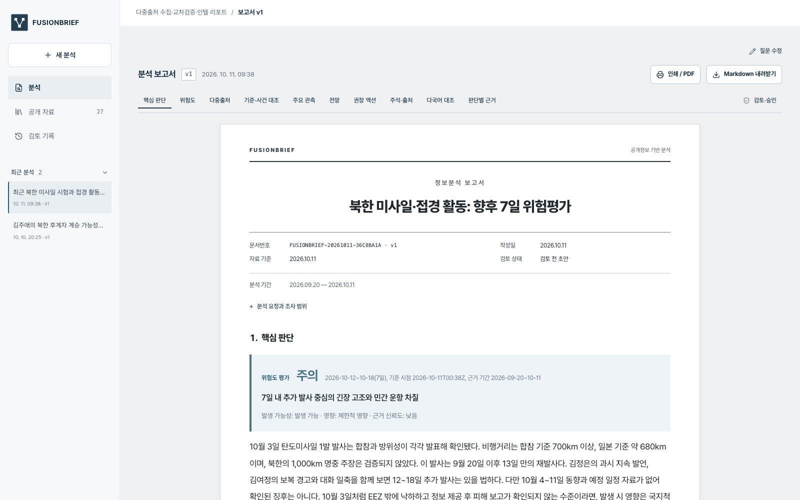

# FUSIONBRIEF — 다중출처 수집·교차검증·인텔 리포트

[English overview](README.md)
자연어 질문을 조사 전략으로 해석하고 여러 공개 출처를 수집·분석·교차검증해 **주장마다 원문 인용과 신뢰도가 연결된 인텔 보고서와 시각화**를 생성하는 Fusion OSINT Copilot입니다.

[로컬 실행](#로컬-실행) · [보존 보고서](https://chanusong.github.io/fusionbrief-osint/) · [설명 영상](https://youtu.be/N5J4tvXNMQ4) · [출품작·수상작 분석](output/submission/reference-analysis.html) · [시연 흐름](DEMO-T2-1.md) · [검증 기록](VERIFICATION-T2-1.md)



## 분석가에게 제공하는 가치

- **자료 조합에서 크리티컬한 인사이트 발굴:** 북한의 무기 성능 주장, 한국·일본의 탐지 결과, 항공·해상 경보를 함께 대조합니다. 관측된 사건, 발표의 충돌, 민간 영향의 정보 공백을 분리하여 어떤 증거가 위험 판단을 바꾸는지 드러냅니다.
- **반복 작업에 쓰는 리소스 감축:** 다국어 검색, 원문 확보, 인용·번역 대조, 중복 출처 확인과 보고서 작성을 연결합니다. 분석가는 자료를 오가는 작업을 줄이고 핵심 판단·후속 확인·승인에 집중합니다. 기준 원문과 판본을 보존해 반복 조사에서도 재사용합니다.
- **근거 온톨로지와 관계 그래프:** 기준·사건·주장·인용·원출처·위험도·권장 액션을 구조화된 관계로 연결하고 무결성을 검사합니다. 결과를 설명 가능한 근거 경로로 추적하며, 근거가 바뀌면 판단·위험도·승인 상태에 반영합니다.
- **보고서에서 다음 결정까지:** 결론과 색상 위험도, 재평가 신호와 권장 액션을 함께 제공합니다. '무슨 자료를 모았는가'에서 '어떤 판단을 내리고 무엇을 확인할 것인가'로 분석을 이어갑니다.

**검증 단계의 리소스 비교:** 원문 확보 후 인용·판단·위험도 검증은 실제 실행 기록으로 **5분 57초**입니다. 같은 검토를 수작업으로 수행하는 예시 가정은 **74분**(인용 22건 × 2분 + 판단·위험 대조 30분)입니다. 사람의 시간은 측정값이 아닌 가정이며, 전체 수집·재검색을 포함한 이 재개 실행은 **19분 14초**입니다. 일부 보존 원문·응답을 재사용한 실행으로, 새 질문의 처리 시간을 보장하지 않습니다.

## 대표 APAC 사례

**최근 북한 미사일 시험과 접경 활동에 따른 향후 7일의 긴장 고조 위험은? 민간 항공·해상 영향을 포함해 위험도와 권장 추가 액션을 분석해줘.**

2026년 10월 사건과 9월 배경을 구분합니다. 확인된 발사 관측과 북한의 기술적 주장, 접경 사건의 조사 결과와 반대 입장을 대조하고 민간 항공·해상의 공개 제한·경보를 확인합니다. 실제 위험 평가는 발생 가능성과 영향의 정성적 행렬로 계산하며 **공식 경보 단계나 통계적 전쟁 확률이 아닙니다**. 근거 신뢰도와 정보 공백을 별도로 표시합니다.

보존한 대표 분석: **실제 원문 27건 / 유효 사건 인용 18건 / 11종 자료 조사 / 위험 항목 3개 / 권장 추가 액션 5개 / 실제 위성 관측 / 대표 보고서 모의 피드 0개 / 실제 공개 관측 수집기 8개**.

11개 자료 유형의 실제 검색·원문 확보·근거 연결을 보여줍니다. 뉴스, 정부 발표, 북한 매체, SNS, 공개 논의, 사진·영상, 위성, 항적, 선박, 논문, 특허를 다룹니다. 실제 Sentinel-2 관측 미리보기와 공개 ADS-B 연구·특허는 관측 한계와 기술 배경으로 구분합니다. 실제 공개 수집기 8개를 추가했습니다: OpenSky·adsb.lol 항공 위치, MyShipTracking 동아시아 선박 AIS 수신 위치, VesselFinder 상태, 인천항만공사 입출항, Fintraffic 핀란드 AIS, 38 North·Martyn Williams의 Bluesky 원문입니다. 제공자별 범위·수신 시각·원문 SHA-256 스냅샷을 표시하고 같은 항공기·선박의 식별자와 관측 시점을 대조합니다. 핀란드 자료는 한반도 사례의 근거에서 제외합니다. 대표 보고서의 모의 예시는 제거했으며, 추가 관측은 보고서 재평가 전까지 기존 위험도를 바꾸지 않습니다.

추가 사례는 김주애 승계 전망, 대만해협 다국어 분석·좌표 지도, 북한군 포로 이송 공개 논란과 별도의 실제 질문 실행 결과입니다.

[로컬 실행](#로컬-실행)에서는 새 질문과 실제 관측 재수집·분석·검토를 실행합니다. GitHub Pages에서는 보존한 보고서와 공개 관측 스냅샷을 열람합니다. 로컬 앱에서도 실제 실행이 가능합니다. 영상에는 실제 실행 기록의 재현과 완료한 결과 탐색을 표시하며 자연스러운 한국어 신경망 TTS를 사용했습니다.

## 합성 시나리오: 자료가 합쳐질 때 판단이 달라지는 사례

[합성 운항 영향 분석](https://chanusong.github.io/fusionbrief-osint/?run=36c8ba1a-bf51-44d5-a240-d7c0e0f8afce#report-insights)에서 가상 경보와 전후 항공·선박 항적을 대조합니다. 실행 시 구역 교차, 최신성, 거리, 원출처 중복과 위험 행렬을 실제로 계산합니다. 입력은 합성이고 규칙 기반 재현 분석이며, 실제 사건이나 새로운 LLM 실행으로 표시하지 않습니다.

- 항공 6/8대·유효 선박 9/10척 우회, 오래된 수신 2척 제외. 서로 다른 경로·수신 간격의 합성 위치 표본을 실제 지리 배경 위에 표시하고, 개체별 속도·침로·수신 시각을 검토할 수 있습니다. 이전 평균 이동 속도를 기준으로 추가 이동 시간을 실행 시 추정합니다. 실제 도착 지연 측정값은 아닙니다.
- **결합 인사이트:** 합성 표본의 평균 추가 이동 추정은 항공 15분, 해상 6시간 5분(약 24.3배)입니다. 경보 원문에는 없는 수단별 부담 격차를 산출해, 해상 항로 복귀와 경보 연장을 우선 확인하도록 보고서 앞부분에 제시합니다. 입력·반대 근거를 바꾸면 요약·전망·근거 그래프도 함께 갱신합니다. 실제 도착 지연이나 군사 공격 전망을 뜻하지 않습니다.
- 항적을 제외하면 위험을 잠재 수준으로 제한하고, 기상 반대 근거를 넣으면 운항 영향은 유지하되 시험경보로의 원인 귀속을 유보합니다.
- 경보 재전파 20건이 추가돼도 같은 원출처로 묶어 신뢰도가 자동 상승하지 않습니다. 원문과 좌표 JSON·기준·근거 경로를 검토하고 경보 만료·항로 복귀·기상 대조를 후속 액션으로 제시합니다.

합성 평가와 실제 북한 보고서·피드는 분리합니다. 위험 지표는 시연용 제품 정의이며 공식 경보나 검증된 운항 예측 모델이 아닙니다.

## 로컬 실행

Node.js 22.13 이상, 로그인한 Cursor CLI, PDF 추출 도구 `pdftotext`가 필요합니다.

```sh
npm ci
agent login
npm run dev
```

`http://127.0.0.1:5176`에서 새 북한 위험 질문이 미리 입력됩니다. **분석 실행 → 실제 검색어·URL·확보 원문·접근 실패를 표시하는 진행 화면 → 보고서**로 전환합니다. 임의 질문과 공개 HTTPS 원문 URL도 사용할 수 있습니다. `.env.example`의 선택 설정을 참고하세요. 모델·검색 호출은 연결된 Cursor 계정의 사용량을 소비합니다. macOS PDF 도구는 `brew install poppler`, Linux에서는 `poppler-utils`를 설치합니다.

## 분석 흐름

1. 플래너가 명제·범위·기간·기준·우선 출처·반증·경쟁 설명·종료 조건을 구성합니다.
2. 질문에 필요한 연구·교범·법규·정책의 원문·판본·적용 범위를 먼저 검증합니다.
3. 다국어 공개 원문·HTML/PDF·초록·특허·북한 발신 자료·STAC 관측을 수집합니다.
4. 인용 위치·해시, 주장 적합성·번역·시간·자료 역할과 원출처 독립성을 검증합니다.
5. 기준별 사건·반대 근거·정보 공백을 대조하며 핵심 전제의 신뢰도로 결론을 제한합니다.
6. 결론, 위험도 색상 그래프, 기준 비교, 조건부 전망, 연표·관계, 주석·출처를 문서로 작성합니다. 의미가 없거나 근거가 없는 시각화는 생략합니다.
7. 권장 액션의 우선순위·공개 확인 출처·담당 역할·기한·재평가 신호·완료 조건을 제시합니다.
8. 분석가가 출처를 검토하고 판단·위험도를 재검증한 뒤 승인·보완 의견을 기록합니다. 근거 변경 시 승인을 해제합니다. A4 인쇄/PDF·Markdown·JSON-LD 내보내기를 지원합니다.

기준 지식은 SQLite FTS5에 원문·해시·판본별 불변 스냅샷으로 보존합니다. 재확인 주기는 자동 삭제 기간이 아니며, 보고서가 인용한 판본을 유지합니다. 온톨로지는 기준·문서 판본·주장·인용·판단·전망·위험도·액션의 타입 관계와 근거 무결성을 검사합니다. 모의 자료는 별도 노드이며 실제 판단의 전제로 연결하지 않습니다.

## 기술과 검증

React · TypeScript · Vite · Node.js · Cursor CLI · Zod · SQLite FTS5 · HTML/PDF · Crossref · Earth Search STAC · Cytoscape · React Flow · Leaflet.

```sh
npm test
npm run test:e2e
npm run build
npm run demo:verify
npm run build:showcase
```

단위 테스트 136개와 기존 브라우저 테스트 20개를 통과했습니다. 인용 위조, 의미·번역·시간 불일치, 출처 중복, 위험도 근거 제한, 모의 자료의 실제 평가 제외, 근거 변경 후 위험도 무효화, 승인 해제, 모바일·원문 연결을 확인합니다. 실제 공개 원문과 모델을 사용한 수집 검증은 검증 기록에 구분합니다. 추가로 실제 API → 원문 해시 검증 → 지도·SNS·항만 화면 → 새로 수집 → 위험도 유지와 모바일 화면을 브라우저에서 확인했습니다.

## 구현 범위

공개 자료만 사용합니다. 북한 발신 매체 24종과 공개 보존본을 탐색 대상으로 두되 모든 발행물의 완전한 수집을 보장하지 않습니다. 상용 AIS/ADS-B 실시간 피드와 상용 고해상도 영상은 미연결입니다. 관측 공백을 부재 증거로 사용하지 않으며, 특허·연구를 실제 배치 근거로 사용하지 않습니다. 조직 인증 기반 공동 승인은 미구현이며 로컬 승인자 이름을 기록합니다. 제품 보고서는 ATP 2-33.4·ODNI ICD 203 공개 분석 원칙을 참고한 양식입니다.

한국어 내레이션은 `ko-KR-SunHiNeural` 신경망 음성으로 합성했습니다. 영상은 Chanwoo Song 채널에 업로드했습니다. 영상과 스크린샷·보고서 PDF는 `output/submission/`에 있습니다. GitHub Pages 경로는 `vite.showcase.config.ts`에서 변경할 수 있습니다.
