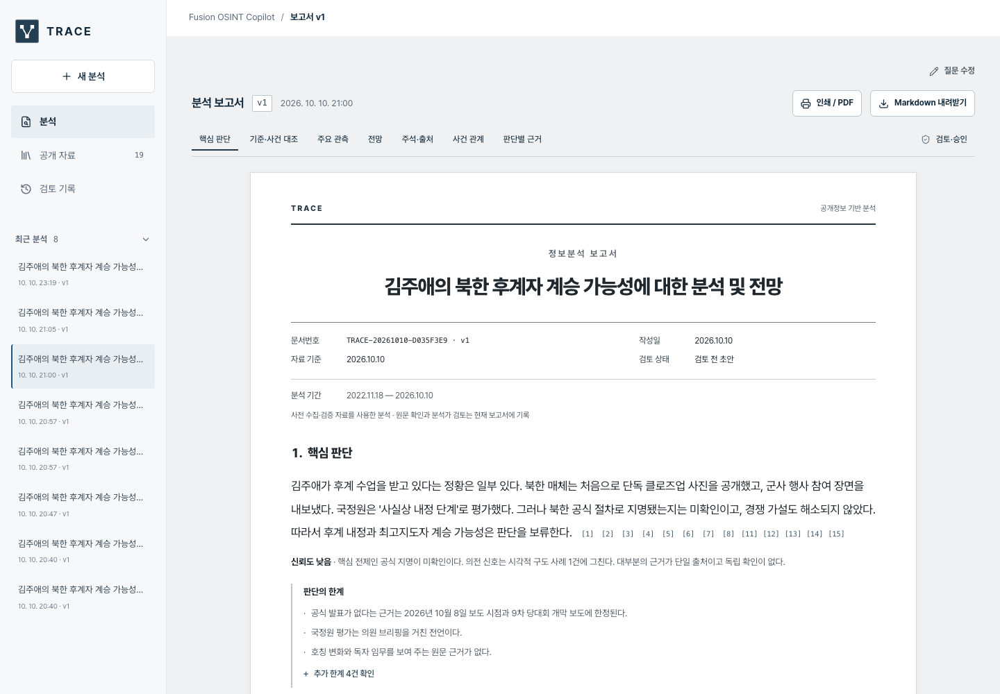

# TRACE — Fusion OSINT Copilot

공개 정보에서 검증 가능한 판단으로. 자연어 질의를 조사 전략으로 해석하고 여러 공개 출처를 수집·교차검증해 **주장마다 원문 인용과 신뢰도가 연결된 정보분석 보고서와 시각화**를 생성합니다.

[웹 데모](https://chanusong.github.io/trace-osint-copilot/) · [설명 영상](https://youtu.be/TZ5jBSRmG78) · [수상작·출품작 분석](output/submission/reference-analysis.html) · [시연 흐름](DEMO-T2-1.md) · [검증 기록](VERIFICATION-T2-1.md)



## 대표 APAC 사례

**김주애의 북한 후계자 계승 가능성은? 근거와 전망을 분석해줘.**

통일연구원·38 North의 분석 틀, 국정원 평가를 전달한 보도, KCNA 공개 전달 원문과 북한 배포 사진을 대조합니다. 후계자 육성 징후, 공식 지정·권한, 최종 승계는 구분합니다. 근거가 부족하면 판단을 유보하고 경쟁 설명·정보 공백·다음 확인을 제공합니다.

- 보존한 대표 분석: **19개 원문 / 15개 유효 사건 인용 / 6개 기준 / 2개 주요 판단 / 3개 조건부 전망 / 1개 검증된 이미지 관측**.
- 새 질문의 별도 실제 실행: **23개 원문 / 19개 유효 인용 / 전체 실행 18분 43초**. `data/showcase/latest-live.json`에 완료한 보고서를 보존했습니다.
- 추가 사례: 대만해협 다국어 원문·좌표 지도·사건 관계, 북한군 포로 이송 공개 논란.

웹 데모는 로그인 없이 **보존한 실제 분석 결과를 탐색**합니다. 영상은 실제 수집 중 저장한 화면과 보존 결과 탐색을 구분합니다. 웹 데모에서 실시간 검색·분석·검토 저장을 실행하지 않습니다.

## 새 질문 분석 실행

Node.js 22.13 이상, 로그인한 Cursor CLI, PDF 추출 도구 `pdftotext`가 필요합니다.

```sh
npm ci
agent login
npm run dev
```

`http://127.0.0.1:5176`에서 김주애 질문이 미리 입력됩니다. **분석 실행** → 실제 검색어·접근 URL·확보 원문·실패가 보이는 진행 화면 → 완료한 보고서로 자동 전환합니다. 임의의 질문과 공개 HTTPS 원문 URL도 사용할 수 있습니다. 선택 설정은 `.env.example`을 참고합니다. Cursor 모델·검색 호출은 로그인 계정의 사용량을 소비합니다.

macOS PDF 도구: `brew install poppler`. Linux: 배포판의 `poppler-utils` 패키지. 모델은 Cursor CLI의 실제 WebSearch와 구조화 분석을 사용합니다. 검색 결과 실행 기록에서 URL을 읽고 공개 원문을 직접 확보합니다. 계정 인증 정보·로컬 설정은 저장소에 포함하지 않습니다.

## 분석 흐름

1. **플래너:** 명제·범위·모호성·자료 전략·반증·경쟁 설명·종료 기준을 구성합니다.
2. **기준 선행 조사:** 필요한 공개 연구·교범·법규·정책의 조항·판본·적용 범위를 검증합니다.
3. **사건 수집:** 정부·뉴스·북한 매체·연구 등 여러 자료 유형과 다국어 원문을 수집합니다.
4. **인용·내용 대조:** 정확한 인용 위치와 원문 해시, 번역·시간·자료 역할·주장 적합성을 별도로 검증합니다.
5. **기준별 사건 대조:** 충족·부분 확인·미확인·반대 근거를 구분하고 핵심 전제의 상태로 판단과 신뢰도를 제한합니다.
6. **원출처 검토:** 같은 발표·번역·배포 사진의 재인용을 독립 확인으로 중복 계산하지 않습니다.
7. **보고서·시각화:** 핵심 판단, 지표 비교, 관측, 경쟁 설명, 전망, 후속 수집, 주석·출처를 문서로 만듭니다. 근거 있는 관계·연표·좌표·이미지만 표시합니다.
8. **분석가 검토:** 원출처 수정·판단 재검증·승인·보완 요청·판본 이력. 근거 변경 시 승인 해제. A4 인쇄/PDF·Markdown·JSON-LD 내보내기.

기준 지식은 SQLite FTS5에 원문·해시·판본별 불변 스냅샷으로 보존합니다. 자료별 재확인 주기는 자동 삭제 기간이 아닙니다. 온톨로지는 기준·조항·문서 판본·주장·인용·판단·전망의 타입 관계를 연결하고 무결성을 검사합니다. OWL 추론 엔진으로 표현하지 않습니다.

## 기술과 검증

React · TypeScript · Vite · Node.js · Cursor CLI · Zod · SQLite FTS5 · HTML/PDF · Crossref · EarthSearch STAC · Cytoscape · React Flow · Leaflet.

```sh
npm test
npm run test:e2e
npm run build
npm run demo:verify
npm run build:showcase
```

단위 테스트는 인용 위조·내용 불일치·번역·시간·원출처·승인 해제·버전 충돌 등을 검사합니다. 브라우저 테스트는 모델 호출을 끄고 별도 저장소를 사용합니다. 실제 공개자료·Cursor를 연결한 수집 검증은 [검증 기록](VERIFICATION-T2-1.md)에 구분합니다.

웹 데모 빌드는 `dist-showcase`에 정적 자료를 생성합니다. `vite.showcase.config.ts`의 GitHub Pages 경로를 다른 저장소에 배포할 때는 수정하세요. 영상과 스크린샷은 `output/submission/`에 있습니다.

## 구현 범위

공개 자료만 사용합니다. 알려진 북한 매체 24종·보존본 검색을 조사 대상으로 두지만, 로동신문 등의 접근 실패를 기록하며 모든 발행물의 완전한 수집을 보장하지 않습니다. SNS·항공·해양·특허는 공개 색인 문서·발표 경로이고 전 세계 실시간 AIS/ADS-B 피드는 미연결입니다. Sentinel-2 STAC 메타데이터·공개 미리보기 수집은 검증했고 질문과 무관하면 생략합니다. 상용 고해상도 영상·전체 영상 프레임 분석은 미연결입니다.

승계 가능성과 근거 신뢰도는 별개이며 통계적으로 보정한 미래 확률을 주장하지 않습니다. 보고서는 ATP 2-33.4·ODNI ICD 203 원칙을 참고한 제품 양식입니다. 조직 인증·공동 검토 권한은 미구현이며 승인자는 로컬 입력 이름으로 기록합니다. 원문·지도·사진에는 각 자료의 출처가 연결되어 있습니다.
